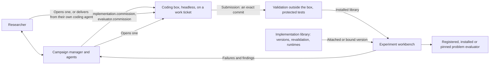

# Implementation service and campaign manager

Implementing an algorithm is separate from measuring its performance. Code is built in one place, a coding workspace: a box in
which a coding agent writes a library under `libraries/<name>/`, which Balsamic validates outside the box and installs into the lab
(roadmap H8: the one route that builds code). The implementation library described here builds nothing and calls no model: it
keeps immutable, validated executable versions, revalidates them, resolves their runtimes, and checks and publishes a package
someone supplies to its own API. The campaign manager coordinates the lab's work and keeps durable context across weeks of
experiments.



## One route builds code (roadmap H8)

A method or an evaluator is built in a coding workspace, whoever asks for it:

- **The implementation lead or the researcher opens one** with a work ticket (`implementation_workspace_create`, or the
  Implementations page), and the coding agent in it works on the ticket's acceptance tests ([the plan](pi-implementation-workspace-plan.md)).
- **A commission opens one by itself.** `implementation.commission` (a proposal's method) and `evaluator.commission` (a task's
  evaluator, when the campaign's charter declares its problem) open a coding workspace in which Pi runs headless
  (`agents/development_commission.py`, roadmap H7), on a work ticket that holds the frozen specification (its provenance and an
  evaluator's independent fixtures left out), behind the box's walls: the egress allowlist, the limits, and the commission's
  `compute_seconds` as its deadline, within the go-ahead's wall time.
- **The researcher delivers from their own coding agent** (own session): the same submission, the same validation.

What a box delivers is a submission. Balsamic validates its exact commit outside the box (`agents/library_validation.py`, H6),
installs the library, binds the proposal or has the declared task adopt the problem, and starts the approved runs.

- **Protected tests.** The test designer's job is done outside the box, before it opens: a commissioner writes at least one
  protected acceptance test (`ticket.protected_tests`), and an evaluator's `correctness_cases` become one Balsamic writes
  (`test_commission_fixtures.py`). They are kept on the host (`development_protected_test`) and run on every delivery; the box
  sees their names only. The specification's behaviour, mechanism and diagnostic checks are part of what the coding agent reads,
  not protected tests.
- **One log, one ledger, one contract.** The workspace's history is the commission's. The bus charges the commission's
  `compute_seconds` to the go-ahead once; the box takes none of its coding workspaces, and its wall time and its validation are
  counted on the box (`commission.usage`), not charged again. The optional implementation ceiling counts boxes, and the service
  jobs recorded before, alike. What the box builds is a library.
- **A commission that cannot open a box is refused**, with what to do instead (`development_commission.refusal()`): while
  coding workspaces are off, the refusal names the switch that turns them on; a commission that brings a package is told to
  deliver the code as a library from the researcher's own coding agent, or to record it as reference code
  (`implementation.reference`) and give it to a coding workspace; an evaluator for a task no charter declares is told to attach
  a validated evaluator version (`evaluator.attach`) or to start the campaign from a charter that declares the problem. Nothing
  reserves a library job for a commission any more.

### What H8 retired

The library's own build route: its agent loop (a builder, a test designer that froze checks, and a model reviewer, run as
implementation grant agents), the grant roles (`implementation_builder`, `implementation_test_designer`,
`implementation_validator`) and their instructions, and the coding workspace's service validation of a submission
(`implementation_workspace_validate`), which validation outside the box replaced in H6. Nothing is migrated and nothing is
hidden: grants, jobs, versions, agent logs and validation results recorded before stay readable on the pages, in campaign
exports and to the agents (`campaign_inspect`, `evidence_read`); a grant whose job was still running finishes and reconciles as
before, and can be cancelled or closed (`implementation.control`). An agent recorded under a retired role takes no more turns.

## The implementation library

The library keeps executable versions, each an immutable artifact with its frozen specification, validation report, runtime
and exposed conditions. Its jobs are mechanical:

- **Importing a supplied package** (`POST /v1/jobs` with a `package`): the package is checked once against the frozen checks
  of its specification, an evaluator's independent `correctness_cases` or an optimizer's `behavior_checks`,
  `mechanism_checks` and `diagnostic_checks`, with four bounded calls to the selected evaluator; a package that passes is
  published as a version, one that fails is a failed job (nothing repairs it). An optimizer specification without behaviour
  or diagnostic checks, and a numerical evaluator's without fixtures, is blocked: nothing designs them here. The version is a library version an experiment can pin (`implementation.attach`,
  `evaluator.attach`); its validation report has no model review (`review: null`).
- **A job without a package** is blocked: the library builds nothing. Commission the method instead.
- **Revalidation** of a published version (below), and **runtime resolution** (below).

New experiments check current profile/evaluator identity and compatibility, then pin source, runtime identity, validation
report, and evaluator code at enqueue. Package versions and schedules distinguish method groups in comparisons. Published
versions do not silently replace previous trials or finalists. An agent's work that commits implementation time needs the
researcher's compute go-ahead (a mandate proposed with `mandate_propose`, whose compute part is a consent:
`campaigns/mandates.py`, `campaigns/compute_consent.py`), like any other work over the go-ahead threshold. **Implementation
compute cap (seconds)** in the charter is only an optional ceiling: 0, the default, sets none, and a positive value caps the
implementation time committed in the campaign. An agent cannot ask to raise it; it asks for a compute go-ahead instead.

`examples/implementation-reference/optimizer.py` is a small seeded NumPy one-bit search used to validate this infrastructure. It
does not implement the Fourier, gradient, or adaptive portfolio proposals and makes no novel algorithm claim. Built-in methods
retain their bundled regression validation and source identities. Legacy custom source retains its historical protocol-only
verification.

Validation attests only to the declared scope and recorded checks. There is no claim of general proof, convergence, empirical
superiority, or independent electromagnetic solver agreement. Known physical conditions exposed during implementation
development/validation follow the version into consuming campaigns; those conditions cannot become fresh confirmation evidence
by copying the implementation.

The general framework also supports a distinct evaluator package kind, unresolved problem declarations and immutable evaluator
bindings. The [evaluator commissioning guide](evaluator-commissioning.md) describes the browser workflow, the independent
fixture contract, typed commands and remaining integration limits. Optimizer requests select their problem and exact evaluator
version; a proposal can remain a saved experiment draft until both are available.

## Run locally

The services share a local filesystem and run as the same trusted user. This is not a remote or multi-tenant execution
service. Install the project with `uv sync --extra dev` and build the frontend with `npm --prefix frontend run build`. Linux
bubblewrap, unprivileged user namespaces, `ldd`, `readelf`, and `ldconfig` are required for isolated package execution.

```bash
# Terminal 1: shared library. It calls no model and needs no model configuration.
uv run grating-implementations --directory runs/implementations --port 8766

# Terminal 2: point any local workspace at that library.
GRATING_IMPLEMENTATIONS_TOKEN_FILE="$PWD/runs/implementations/service.token" \
  uv run grating-lab --directory runs/workspace --port 8765
```

A user-systemd template is provided in `deploy/grating-implementations.service`; replace `@REPOSITORY@` with the checkout path
before installing it. The current local deployment uses this unit and the default library directory.

Without an explicit directory, the library lives at `~/.local/share/grating-lab/implementations`. The implementation client
defaults to `http://127.0.0.1:8766`; override `GRATING_IMPLEMENTATIONS_URL` when needed. Authentication uses the service's
generated mode-0600 token file, read by the workspace server, never the browser. `GRATING_IMPLEMENTATIONS_TOKEN` is an
alternative for the server process. Keep tokens out of campaign records and exports.

The service snapshots requested exact dependency versions from the installed environment, including their resolved dependencies
and file hashes. Optional `--allow-wheel-downloads` permits acquisition of registry wheels with `uv`; source builds are
prohibited. Missing wheels, native libraries, isolation, or evaluator capabilities remain explicit blockers. Native wheel
dependencies are inspected with `readelf`, not executed by the host during inspection. Heavy ML runtimes may exceed the present
sandbox's 4 GiB virtual-memory or 10-second operation limits and require a reviewed runtime/profile extension.

## Durability and budgets

The library has its own SQLite queue, exclusive service lease, content-addressed artifact tree, and locked runtime tree. One job runs at a time, and a job is idempotent by its key: a lost response can be reconciled without duplicate work. A checked attempt's report survives interruption, and an interrupted job is resumed once it is safe to.

Completed and failed jobs retain actual usage. An unobserved crash interval is conservatively charged within the fixed grant. A job recorded before H8 that was waiting on a model call when the library restarted enters `needs_reconciliation`; **Retain recorded usage and close** never replays the call. Cancellation retains completed work and in-flight accounting. Long individual native operations may finish at their bounded operation boundary; the separate experiment stop channel remains available.

Revocation prevents new bindings and launches, including recovery attempts. Historical experiments keep their pinned artifacts and evidence; already running work retains its captured code and produces a manager issue. A changed evaluator (code or dependency versions), validation profile, package, or runtime requires fresh validation for new use.

The authenticated `POST /v1/versions/{id}/validations` endpoint accepts a `RevalidationRequest` naming the published version, an independent `checks` specification, a compute grant and an idempotency key. Like every job here since H8, it makes no build or model call. Additional evaluator fixtures or optimizer behavior checks extend the retained check set; they cannot replace prior fixtures under the same name or conceal a counterexample. The old `JobRequest` envelope translates into this mechanical check path for compatibility. Corrected source or changed dependencies create a new executable version.

Reports are append-only and available at `GET /v1/versions/{id}/validations`. Failed rechecks block use, including when a later narrower request would otherwise pass. The workspace retains its own immutable record of when each executable evidence state became known. Confirmation and nomination reassessment consume that evidence without rewriting earlier observations, cutoff evidence or issued reports. Runtime availability affects new execution; losing an installation directory alone does not invalidate a historical measurement.

Back up the library database, `artifacts/`, and `runtimes/` together with workspace databases and trial directories. These backups preserve local recovery state. [Portable evidence bundles](evidence-bundles.md) provide a separate result/dependency transfer workflow.

## Local runtime resolution

New executable artifacts use schema 2. Their identities include source, frozen
specification, protocol and runtime content, but exclude installation locations.
The runtime pins the interpreter, platform/ABI, copied standard library,
dependency files and native libraries. Local bindings retain filesystem paths
and any loader aliases required by the operating system. The sandbox uses the
captured standard library; unexpected bytecode or changed dependency files fail
verification. Identical source and runtime content published in two directories
now produce the same executable identity.

In the implementation library, **Check local runtime** reports availability
independently of correctness evidence. **Resolve compatible runtime** uses the
shared `implementation.resolve_runtime` command to verify matching dependencies
already installed on the service. This operation does not call a model, download
dependencies, initialize candidate code, or replace validation reports. A damaged
installation is retained while a verified replacement receives a new local
binding. Before a prepared experiment launches or resumes, its operational
binding can be refreshed without rewriting its frozen bundle or specification.

Each explicit resolution has a durable operation and immutable receipt. The
workspace recovers an accepted receipt after a lost reply, including after later
campaign guidance, without repeating the operation. An interruption before the
receipt leaves elapsed work unknown. A mismatch remains unavailable and reaches
the campaign manager as one scoped issue. Intact source and historical evidence
remain inspectable when a local runtime binding is absent or damaged.

Legacy artifacts and runtime hashes remain unchanged and retain their existing
reader and execution path. Automatic conversion of legacy manifests with
embedded system paths is not implemented; relocating those runtimes requires an
explicitly verified converter. A matching schema-2 runtime can be resolved in a
new library directory. The [bundle workflow](evidence-bundles.md) stages and
publishes its source, reports and historical production receipts separately;
imported versions require local revalidation before new use.

## API boundaries

| Owner | Interface | Purpose |
|---|---|---|
| Workspace | `POST /api/v1/commands` | Revision-checked, idempotent commands: a commission (it opens a coding box), attachment, binding, revalidation, runtime resolution and the control of grants recorded before H8; draft save/launch |
| Workspace | `GET /api/v1/evaluator-contracts` | Evaluator manifest, specification and package schemas |
| Workspace | `GET /api/v1/implementations` | Refresh shared version metadata |
| Workspace | `GET /api/v1/implementations/{id}/runtime?campaign_id=…` | Inspect local runtime availability, pending operations and resolution receipts |
| Workspace | `GET/POST /api/campaigns/{id}/implementation-workspaces`, and each one's `timeline`, `messages`, `controls` and `submissions/{id}/install` | The coding workspaces: open, follow, steer, install what one delivered |
| Library | `POST /v1/jobs`, `GET /v1/jobs/{id}` | Idempotent jobs: a supplied package's check and publication; jobs recorded before with their full attempt records |
| Library | `GET /v1/versions`, `GET /v1/versions/{id}/artifact` | Library metadata and verified artifacts |
| Library | `POST /v1/versions/{id}/validations`, `/revoke` | Revalidate exact source or withdraw a version |
| Library | `GET /v1/versions/{id}/runtime`, `POST /v1/versions/{id}/runtime/resolve` | Inspect availability or explicitly resolve exact installed runtime content |
| Library | `GET /v1/runtime-resolutions?workspace_id=…&idempotency_key=…` | Recover a previously accepted resolution receipt |
| Library | `GET /v1/events?after=…` | Ascending, cursor-based durable event stream |

## Existing workspace migration

The migration is additive. It does not rewrite campaigns, trials, hypotheses, messages, historical verification claims, or frozen protocols. Existing implementation compute defaults to zero. A dry run uses SQLite backup to copy a live database consistently and verifies historical record digests on that copy:

```bash
uv run python -m dqn_meent.workspace.migrate_manager \
  --directory runs/workspace --report /tmp/manager-migration.json

# Stop the workspace HTTP supervisor first; the migration requires its lease.
uv run python -m dqn_meent.workspace.migrate_manager \
  --directory runs/workspace --apply \
  --backup runs/backups/workspace-before-manager.sqlite3
```

Retain the database backup and old trial/library artifacts when rolling back application code. Manager projections are rebuildable from canonical SQLite records. Direct edits to projection files are not imported: use the versioned UI or context API to change guidance.

## Verification

`tests/test_commission_box.py` exercises a commission's headless box from ticket to an install validated outside the box, an
evaluator commission, the go-ahead charged once, and the refusals of a commission that cannot open a box.
`tests/test_implementation_service.py` exercises the library's own API: a job without a package blocked, a specification without
checks blocked, a failing package failed once, authentication and idempotency, tamper refusal, cancellation, a pre-H8 job
conservatively charged at a restart, and revalidation. `tests/test_framework_evaluators.py` and the framework suites import
real isolated packages through it and run them in experiments. Existing optimizer regression tests cover all seven built-ins.
