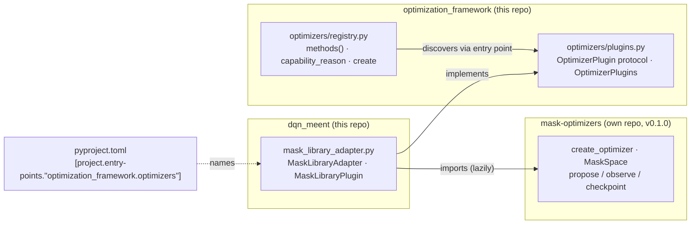

# Optimizer libraries and plug-ins

**Status:** adopted 2026-10-07. **Applies to:** every optimizer that is not part of
`optimization_framework` itself, starting with [`mask-optimizers`](https://github.com/kc-ml2/mask-optimizers).

## The decision in five lines

1. Reusable optimizer code lives in **its own versioned package and repository**, with no knowledge of Balsamic.
2. The project that wants it adds a small **adapter** that translates between the package and the project's problem.
3. The adapter **registers itself** through a Python entry point in the `optimization_framework.optimizers` group.
4. The framework **discovers** registered methods; it never imports a library or adapter by name.
5. The project pins the package (`masks` extra, git tag, lock file), and frozen runs record which plug-in and library version produced each result.

The rest of this document explains why each line exists, how the pieces fit at run time, and how to apply the
pattern to the next library.

## The problem this solves

Before this change, `optimization_framework/optimizers/registry.py` contained:

```python
MASK_LIBRARY_METHODS = {"motif_surgery", "nested_fourier", "phenotype_de"}
...
if name in MASK_LIBRARY_METHODS:
    from dqn_meent.mask_library_adapter import MaskLibraryAdapter
```

Three things were wrong with that, and each is a general hazard:

| Symptom | General hazard |
|---|---|
| The general framework imported one project's module (`dqn_meent...`). | **Dependency points the wrong way.** A second project could not use the framework without also carrying `dqn_meent`, and every new library meant editing the framework. |
| The library existed only as a local wheel, not declared in `pyproject.toml`. | **Unreproducible environment.** A fresh clone failed 13 tests, and `uv sync` silently uninstalled the library. |
| Method lists, parameter schemas and validation for the library lived in the framework. | **Knowledge in the wrong place.** Whoever changed the library also had to change the framework. |

## The pattern: three layers and one seam



Read the arrows as "knows about". The **library** knows about nothing. The **adapter** knows about the
library and the framework's contract. The **framework** knows only its own contract. Its single connection to the
adapter is a string in package metadata, the **seam**.

This is the [dependency inversion principle](https://en.wikipedia.org/wiki/Dependency_inversion_principle)
applied to packaging. The framework owns the interface (`OptimizerPlugin`), and concrete implementations depend on
it, not the other way round. It is also a small instance of
[ports and adapters](https://alistair.cockburn.us/hexagonal-architecture/): the plug-in contract is the port, and
`MaskLibraryPlugin` is an adapter.

### What belongs in each layer

| Layer | Depends on | Knows | Lives in | Example here |
|---|---|---|---|---|
| **Generic library** | NumPy-level packages only | Arrays, scalars, callbacks; its own checkpoint format | Its own repo, tagged releases | `mask-optimizers`: x-major masks, maximize a scalar utility |
| **Domain toolbox** | Generic libraries and a domain package (e.g. MEENT) | Physics or domain data types, but not Balsamic | Its own repo once two projects use it | None yet; MEENT-specific evaluators or decoders would qualify |
| **Project adapter / plug-in** | The library or toolbox and the framework contract | Both sides' conventions; translates between them | The project | `dqn_meent/mask_library_adapter.py` |
| **Framework** | Nothing project-specific | Its contracts, discovery and provenance | `optimization_framework` | `optimizers/plugins.py`, `optimizers/registry.py` |

The test for "is this in the right layer?" is to ask **what would have to change if X changed**:

- If MEENT's grid order changed, only the adapter's `_to_campaign`/`_to_library` should change. Translation belongs at the boundary.
- If the framework's descriptor format changed, only `MaskLibraryPlugin.methods()` should change. The library is untouched.
- If the library gained a method, the library and one line of the adapter's `METHODS` change. The framework is untouched.

### Generic library, domain toolbox, or project code?

Answer these questions in order for each new piece of optimizer code:

1. **Does it import a simulator, a physics model, or a Balsamic type?** If not, and its interface is numbers, arrays
   and callbacks, it is **generic**. `mask-optimizers` passes this test: the caller supplies `score` and, for
   gradient methods, a `relaxed_gradient` callback.
2. **Does it need domain types but not Balsamic?** Then it is a **domain toolbox**.
3. **Does it need Balsamic's contracts** (`ProblemInstance`, `Proposal`, campaign records)? Then it is **adapter or
   project code**, and it stays in the project.

Then decide **where** it lives with the *rule of two*. Code with one user stays in that project, written so it
obeys
the dependency rule, so that extraction later is a move, not a rewrite. When a second project needs it, move it to
its own repository with its tests and validation evidence, as `mask-optimizers` carries
`reports/standalone-validation-20260930/`.

### Libraries built in a campaign

Implementing a proposal's method is building a library on this pattern, separate from the rest of Balsamic. Whether the
method performs well is for experiments and the researcher to judge; the library only has to implement its
specification. A coding workspace builds it under `libraries/<name>/` (`libraries/grating-mask-search` is the first):

- a module per method on the `optimizer_v1` package contract (`create_optimizer(context)`, then `initialize`,
  `propose`, `observe`, `checkpoint` as bytes, `restore`, `inspect`; `propose` returns `[]` when the method has
  finished, see "Finishing"), with no Balsamic imports, so the same module also runs as a package in the implementation
  service. The context carries `dimensions` (the candidate's length), `seed`, `parameters`, `problem` (the descriptor
  `initialize` also receives) and `capabilities`, and where it runs as a package `schedule_steps` and `declared_assets`. It also carries `n_cells`, the same count under the
  grating's name: it is deprecated and stays only for existing libraries, so read `dimensions`;
- the implementer's tests of each method against its specification;
- `plugin.py`, a `PackagedPlugin` subclass (`optimization_framework/optimizers/packaged.py`) that lists the methods and
  runs each module in-process, registered under the entry point in the library's `pyproject.toml`. It says which
  candidates its methods accept: `REPRESENTATIONS = ["continuous"]` on the class covers every method, and a method's own
  `representations` in `METHODS` overrides it. A library that declares neither is treated as binary-only, as the grating
  library is, and a method on that default that does not fit a task's problem says "the library declares no
  representations, so it is treated as binary; declare REPRESENTATIONS";
- `tests/test_contract.py`, which runs `optimization_framework.optimizers.conformance.check` on each method: valid
  candidates, seeded replay, checkpoint continuation, JSON checkpoints and a small inspection (at most
  `DIAGNOSTICS_BYTES`, 16 kB: the host records `inspect()` after every evaluation, so it holds counters and a recent tail,
  never a design or a whole history; the worker replaces any larger value by its size), and exports whose `kind` the asset
  catalog holds (`AssetKind`: a best design is a `solution`, a search log `learner_diagnostics`), without a solver. A run's
  export of another kind is not cataloged: it stays in the run's files and is listed in the trial's `uncataloged_outputs`.

The library is done when `uv run pytest libraries/<name>` passes. Installing it runs its code in the lab's workers, as
`mask-optimizers` does. Balsamic installs a delivered library by itself (not one its coding agent reports not ready; set
`GRATING_AUTO_INSTALL=false` to stop it), and the researcher can install again with Install on the coding workspace's card
(Hypotheses → Implementations). Either way Balsamic first validates the exact submitted commit outside the coding box
(roadmap H6, `agents/library_validation.py`): in a bubblewrap sandbox with no network and none of the lab's data, it runs
the library's own tests, each method's conformance (`check_function` for a plain-function method, `check` for any other, on
the library's own problem or a task of the campaign it runs on) and the workspace's protected acceptance tests, which the
box never sees. A failure no method owns installs nothing; a method that fails is not installed, bound or run
(`refused_methods`), while the methods that pass are installed; the install records the host's results beside the coding
agent's report (`host_validation`, protected tests by name and outcome only), and the coding agent gets them in a result
file (`/bridge/in/results/` in the box) with one message. pytest must be in the lab's environment (`uv sync --extra dev`). Then it copies the
exact submitted commit's `libraries/<name>/` from the workspace, pins it in the root `pyproject.toml` as an
editable path dependency in the `libraries` extra, and runs `uv lock` and `uv sync --inexact --extra libraries`. A dry run
comes first: a change to a package the lab already has waits for the researcher's confirmation, and a failure puts
`pyproject.toml`, `uv.lock` and `libraries/` back as they were. A library provides methods (`optimization_framework.optimizers`
entry points), problems (`optimization_framework.problems`, one entry point per problem id), or both. A problem id, plug-in
name or method id that another installed package provides, the lab's own included, is refused before uv runs ("problem <id>
is provided by <distribution>"); the library's own earlier version is no clash. Each install is a `library_install` record
with the methods and problems it added and those that did not load (`methods_added`, `missing_methods`, `problems_added`,
`missing_problems`; `agents/library_install.py`); the researcher commits the edited `pyproject.toml` and `uv.lock`. A new delivery of the
same library needs a new version: the running lab loads a library's new code only when its version changes. A new version keeps what
campaigns use (roadmap L1, decision 25): a method or problem the installed version provides that the new one leaves out, or a
kept method that fails validation outside the box, refuses the install when any campaign of the lab ran the method, has a
proposal bound to it or a task on the problem. A method whose behaviour changes gets a new name (`foo_v2`); a changed scoring
function is a new problem id. Unused methods and problems may go (`methods_removed`, `problems_removed`; `methods_kept`,
`problems_kept`). Each library has its own Git repository on the host, `<data>/library_repositories/<name>.git` (roadmap L2): an
install commits the version's files onto its `main` as Balsamic's own commit (the source commit, workspace and campaign in the
message), writes the lab's copy from that commit, and once it is in tags it `v<version>` and records a `library_version` (its
parent, source, methods and problems, what it added and removed). A version, once tagged, never changes: the same version with
other code is refused. What the lab had before (L1's archive in `<data>/library_archive/`, a library committed with the lab) is
imported as the first versions. `GET /api/libraries` and `GET /api/libraries/<name>` list them; the Packages page shows them. A coding workspace whose library has an installed version builds on
the latest one (roadmap L3): it starts from that version's files instead of the library generated from the charter, its ticket
(TASK.md, "What you build on") lists the existing methods and says what a new version keeps, the review's diff is against that
version (`base_version`), and the install records it. `charter.json` and the data stay fixed against the base. The researcher's
own session (`balsamic-workspace clone`) gets the same start. A new version is validated against what came before (roadmap L4): every earlier
version's tests it changed or dropped and every earlier workspace's protected tests on the library run beside its own, and
each method and problem it keeps replays up to 3 recorded runs for 8 evaluations, a method proposing the recorded candidates
and a problem scoring them the same. A changed behaviour under a kept name is refused; give it a new name (decision 25). The running lab lists its methods for the
problems they name at the next listing, without a restart (see "Installed while the lab runs" below). A proposal runs a method once it is bound to it (`implementation.bind_builtin`). After an install Balsamic binds each proposal the delivery serves by itself, when exactly one of the methods
the delivery reports for it is installed and runs on a current task: through the command bus as its system actor `balsamic`, citing the install, which lists
its `bindings` and the proposals it `skipped` with why (a proposal someone bound, one using another method, one with several candidates). A binding keeps the
proposal's concept review: the review's revision counts the configuration the first binding replaced (`pre_binding_config`). Then
Balsamic starts the runs an approved compute plan lists for the proposals that can now run, one per planned seed, under that
go-ahead (`campaigns/plan_runs.py`; the install lists them as `launched`), and wakes the lead once when all of a plan's runs have
ended. When a library provides the problem a campaign's charter declares, `campaign.adopt_problem` (the researcher or the lead; it starts no compute) has the campaign adopt it: its tasks are compiled again from the charter, each declared task is replaced by a new one naming what provides it (`provided_by`: package, version, commit, submission, install), the old one is kept, never rebound, with `superseded_by_task_id`, and an `evaluator_requirement_satisfaction` record links its evaluator requirement to the install; one campaign version and one new study for the adoption, and adopting again changes nothing. Balsamic adopts by itself, first after an install and before binding, when none of the declared tasks has a bound evaluator or live runs; otherwise the install records `adoption_skipped` with the reason, and its notice tells the lead to use `campaign.adopt_problem`. The install lists what it `adopted`. Frozen runs
snapshot the library's source and record its version like any other plug-in. When a second project needs a library, it
moves to its own repository, as `mask-optimizers` did.

## The seam: Python entry points

An [entry point](https://packaging.python.org/en/latest/specifications/entry-points/) is a name → `module:object`
mapping that a package records in its installed metadata. Anyone can enumerate a group without importing anything:

```toml
# pyproject.toml of the package that provides the plug-in
[project.entry-points."optimization_framework.optimizers"]
mask_optimizers = "dqn_meent.mask_library_adapter:MaskLibraryPlugin"
```

```python
from importlib import metadata
metadata.entry_points(group="optimization_framework.optimizers")
# -> [EntryPoint(name='mask_optimizers', value='dqn_meent.mask_library_adapter:MaskLibraryPlugin', ...)]
```

pytest plug-ins and console scripts use the same mechanism, described in the Python Packaging guide
[Creating and discovering plugins](https://packaging.python.org/en/latest/guides/creating-and-discovering-plugins/).
This repository already used it for problems (`optimization_framework.problems`), inference adapters and recipes.
Optimizers now follow the same convention.

Three consequences to remember:

- **Listing is free; loading is not.** `entry_points()` reads metadata only, while `.load()` imports the module.
  The framework loads plug-ins on first use (`registry.methods()`), never at import, so services start without
  importing numerical packages. `tests/test_framework_contracts.py::test_application_starts_with_numerical_domain_imports_blocked`
  enforces this. The first draft of this change loaded plug-ins at import and failed that test, so keep it in mind
  when you add a registry.
- **Installed while the lab runs.** The installed registry compares what is installed (each entry and its
  distribution's version) with what it loaded, at most once a second (`installed.RECHECK_SECONDS`). On a change it
  reloads: the directories that new `.pth` files name (an editable install) join `sys.path`, as at a restart, the
  modules of a plug-in upgraded in place import afresh, and `registry.methods()` rebuilds its descriptors. The lab's
  own packages (`src/`) are never re-imported. Runs already queued keep the plug-ins captured in their manifests.
  The problem registry (`evaluation/registry.py`, `problems`) follows installs the same way, through the same helpers in
  `optimization_framework/installed.py`: a new problem is listed, one upgraded in place loads afresh, and one removed
  is no longer listed. Frozen hosts' registries (`from_entries()`) and `extended()` copies never change.
- Entry points are recorded **at install time**. After adding or renaming one, run `uv sync`; an editable install
  does not see new entry points until then.
- The framework imports only the module named in metadata, and only an administrator can change it. Model output
  selects **method IDs**, never import paths.

## The contract

`optimization_framework/optimizers/plugins.py` defines what a plug-in must provide:

```python
class OptimizerPlugin(Protocol):
    def methods(self) -> list[dict]: ...                 # method descriptors
    def unavailable_reason(self) -> str | None: ...      # e.g. "Install mask-optimizers 0.1.0 ..."
    def validate(self, name, instance, parameters): ...  # raise ValueError for invalid values
    def create(self, name, instance, parameters, seed): ...  # an optimizer object
```

A descriptor carries `id`, `name`, `description`, `representations`, `constraints`, `parameters` and
`parameter_properties` (JSON Schema properties). It may also carry `problem_ids` and `completion_units`. The
framework then adds the parts it owns: the `optimizer_v1` contract fields, the closed `parameter_schema`, and the
execution capabilities (`registry._declare`). A plug-in describes **what its methods accept**, and the framework
decides **how they execute**.

The optimizer that `create` returns follows the framework's ask/tell lifecycle: `propose`, `observe`,
`checkpoint`, `restore`, `inspect`, `export_artifacts` and `close`. `MaskLibraryAdapter` wraps the library's own
optimizer and converts candidates between x-major and y-major order on the way in and out.

### Finishing

A method may end on its own: a one-shot heuristic after its design, an enumeration after its last candidate, a search
that converged. **Return `[]` from `propose` to finish** (or raise `StopIteration`, optionally with a reason:
`raise StopIteration("all 40,320 orders tried")`); an ask/tell optimizer raises `StopIteration` from `ask`. The wrapper
raises `MethodFinished` (`optimizers/finish.py`) and the worker records the run as `completed` with reason
`method_finished`: its best, final checkpoint and outputs are kept as on any completion, and its result says
`method_finished: true` and `scientific_complete: true` (the method's reason, if any, is `finish_reason`). Its last
`inspect()` is kept as `final_inspection`: an exact method puts its proof there, `{"bound": x, "proved_optimal": true}`
(a solver its dual bound). Resuming or continuing such a run finishes at once. Any other exception still fails the run.

In a comparison a finished run holds its final value after its last point (`held_after_finish` on its row), and the
matched cost is set by the runs that did not finish, so one early finisher does not shrink every method's horizon. When
every compared run finished, they are compared at the shortest. The contract checks (`conformance.check`) accept a method
that finishes, as long as the same seed finishes at the same step and a restored checkpoint finishes too.

The whole plug-in for the mask library is about 20 lines:

```python
class MaskLibraryPlugin:
    def methods(self):
        return [{"id": name, "name": title, "description": "Standalone mask-optimizers method on the 2D MEENT grid.",
                 "problem_ids": ["meent_2d_dual_polarization_deflector"], "representations": ["binary"],
                 "constraints": False, "parameters": {}, "parameter_properties": PROPERTIES[name]}
                for name, title in METHODS.items()]

    def unavailable_reason(self):
        return None if library_available() else f"Install mask-optimizers {LIBRARY_VERSION} before using this campaign method"

    def validate(self, name, instance, parameters):
        if parameters.get("modes_x", 8) > 16 or parameters.get("modes_y", 4) > 8:
            raise ValueError("Mask-library Fourier modes exceed the supported basis")

    def create(self, name, instance, parameters, seed):
        return MaskLibraryAdapter(name, instance, parameters, seed)
```

### Plain-function methods

A few lines of search should not need the six calls of the ask/tell contract. A library can offer plain functions
instead (`optimizers/functions.py`):

```python
# <pkg>/methods.py
METHODS = {"greedy_order": {"name": "Earliest due date", "description": "Sort by due date, then evaluate once.",
                            "hypothesis_id": "hypothesis_2"}}

def greedy_order(problem, evaluate, rng):
    evaluate(sorted(range(len(problem["public"]["due"])), key=problem["public"]["due"].__getitem__))
    return "one order evaluated"

# <pkg>/plugin.py, named by the entry point
from optimization_framework.optimizers.functions import FunctionPlugin

class Plugin(FunctionPlugin):
    MODULE = "<pkg>.methods"
    REPRESENTATIONS = ["permutation"]
```

- **The function.** `def <method_id>(problem, evaluate, rng) -> None`. `evaluate(candidate)` records the candidate and
  returns its primary objective in the charter's units and direction; it raises `ValueError` for a candidate that was not
  evaluated and `StopSearch` (a `BaseException`) once the run is over. Returning finishes the method (a returned string is
  its reason). `rng` is a seeded `numpy.random.Generator`, and `random` and `np.random` are seeded from the same seed.
  `problem` is the library's own problem object when the plug-in's `problem(instance)` gives one, else a read-only view of
  the instance's descriptor.
- **Listing runs none of it.** `METHODS` is a literal: `FunctionPlugin.methods()` reads it from the module's source
  (`find_spec`, then `ast.literal_eval`) and never imports the module, so agent code does not run in the server, and a
  module that imports something only the worker has is still listed. Each entry has `name` and `description`, and may
  have `hypothesis_id`, `parameters` (defaults), `parameter_properties` (their JSON Schema), `representations`,
  `problem_ids`, `completion_units` and `stochastic` (false when its runs do not depend on the seed; a function marked
  `@deterministic` says the same). An undeclared method counts as stochastic: before an agent may stop it as inferior it
  needs two seeds per configuration (decision 14), and a false declaration fails conformance. A key must be the name of a public function in the module; `create()` refuses one
  that is not.
- **The worker imports it.** `create()` imports the module, in the worker only, and wraps the function in a
  `FunctionMethod`: each `evaluate` is one proposal and its observation, the checkpoint is the journal of answers, and a
  resume runs the function again from the start and answers from the journal, refusing it if the function proposes
  another candidate ("not deterministic for its seed"). A frozen capture pins the module's source with the plug-in's
  (`OptimizerPlugins.worker_modules()`), though no static import reaches it.
- **Seeded workers.** Workers start with `PYTHONHASHSEED=0` in both launch paths, so iterating a set of strings goes in
  the same order in every run. The isolated worker starts Python with `-s -P -S` instead of `-I`, which would ignore the
  variable, and sets `PYTHONPATH` only once it runs, so at startup only the standard library is importable, as before.
- **Conformance.** `conformance.check_function(plugin, method_id, instance, *, seeds=(0, 7), max_evaluations=50)` runs the
  method on the problem the instance resolves to, so a library's own evaluator is what it runs: every candidate valid,
  the same candidates for the same seed, a checkpoint at half the run continuing to the same run, and a clean end, by
  returning or at the cap. Each distinct candidate is evaluated once, so the replays compare what the method proposes,
  not the evaluator's noise.

### A library generated from a charter

`scaffold(charter, revision, balsamic=True)` (`problem_charter/scaffold.py`) generates a project that is already such a
library. Besides the standalone project (the data, the harness, `objective.py` and `methods.py` to fill), it writes:

- `<pkg>/adapter.py`, with two factories named by the entry points in `pyproject.toml`. `problem_adapter()`
  (`optimization_framework.problems`, under the charter's problem id; only when the charter's evaluator is `declared`) is
  `problem_charter/library.py` `CharterProblem`: its definition and instances are what `charter.manifest()` gives for the
  same values, from the charter the library holds in `data.CHARTER`, and its evaluator calls
  `objective.objective(problem, candidate)` on the library's own `Problem`. `method_plugin()`
  (`optimization_framework.optimizers`, under the package name) is a `FunctionPlugin` with `MODULE = "<pkg>.methods"`,
  the charter's representation, and `problem(instance)` giving each method the library's `Problem`. Balsamic is imported
  only inside these functions, so the project runs without it.
- `tests/test_contract.py`: `compare_provided()` finds no difference between the library's problem and the charter's,
  and `check_function` passes for every method. It skips where Balsamic is not installed.

Describing and resolving the problem read only `data.py`; the library's objective and problem are imported when a worker
evaluates. The evaluator's version is the charter revision and a hash of the package's code other than `methods.py`, so a
changed objective is another evaluator. A field mapped to a derived quantity (the residence time from a volume and a flow
rate) must agree with what the charter computes; a configuration that is none of the charter's instances gets a
`Problem` of its own, resolved from the charter.

A coding workspace of a campaign made from a charter starts from this library (`agents/development.py`
`generated_library()`): the workspace's first preparation writes it into `libraries/<problem-id>/` of the worktree, never
over a file that is already there, and records the hash of each generated file. Its work ticket (`TASK.md`, below) gives
each proposal it serves the `METHODS` key to write it under, with its `hypothesis_id`, and lists the library's generated
tests as its acceptance tests. Under decision 9, `charter.json` and `data.py` are fixed:
the install refuses a delivery whose copies differ from the generated ones ("the library's data no longer matches the
charter revision"), and lists the other generated files the coding agent changed (`changed_generated_files`; the
objective and the methods, which it writes, are not listed). A charter with no evaluator gives no library, and the ticket
says why; the coding agent then builds one as this page describes.

The work ticket (`agents/development_ticket.py`, a `development_ticket` recorded when the workspace opens) is what the
coding agent is asked to do, written into the worktree beside the library as four files: `TASK.md` (the proposals with
their mechanisms and `METHODS` keys, the charter revision, the acceptance tests, the budget of the request's mandate, the
deadline, limits and network of the box), `AGENTS.md` and `CLAUDE.md` (the same house rules for any harness: what to
build, how to run the tests, how to submit, what not to touch) and `.balsamic/spec.json` (the ticket as JSON). Like the
library, each file is written only where it is absent. The implementation lead adds acceptance tests (a pytest file by its
path, with its content when it is new; a campaign without a charter needs at least one) and protected tests, which stay on
the host (`development_protected_test`), are never written into the box, and run in the validation outside the box above
on every delivery. An agent's ticket is checked as a commission's
specification is (`check_self_contained()`): it needs acceptance tests and may name only records the coding agent can read.
Each delivery is reviewed by its diff against the generated base (files and lines changed, the generated files and
acceptance tests it touched), on the submission and in `implementation_workspace_inspect`, beside the host's validation of
it (`host_validation`, `refused_methods`).

### Access, cost axes and threads

A problem says how methods may reach its objective and what they are compared on (roadmap N11, decisions 22 and 23):

- **Access.** `white_box` (the default) or `oracle`. On a white-box problem a method may compute the objective itself, as
  often as it likes: a function method's `problem` then has `problem.objective(candidate)`, the primary objective computed
  by the problem's own evaluator in the charter's units and direction, and a generated library's methods may call its
  `objective.py`. Those calls are not observations and are not counted; `evaluate` is still how a candidate is recorded
  and how the run's best is known. On an `oracle` problem (an expensive evaluator such as MEENT, or a black-box comparison
  the researcher wants) `problem` has no `objective`, and a method reaches the objective only through `evaluate`.
- **Where it is declared.** First to last: the charter's `evaluator.access` (the Charter page's "How methods reach the
  objective"), the problem's `ProblemDefinition.access`, its pack's `cost` section (`ProblemPack.cost`, MEENT's says
  `oracle`), then `white_box`. A declared problem's manifest carries the charter's choice. A task records the result when
  it is created (`evaluation/access.py`), and a white-box run records `access` in its frozen schedule. A task or a manifest
  made before N11 has no access and reads as `oracle`, so its digests and its runs are what they were.
- **Cost axes.** `worker_seconds`, `core_seconds`, `evaluations` or `solver_calls`, declared like the access. Unset, the
  comparison report uses time: `worker_seconds`, or `core_seconds` when a white-box run used several threads. Every cost
  row records `core_seconds = numerical_threads × worker_seconds`. On `core_seconds` runs on different thread counts are
  compared together; on `worker_seconds` a run on several threads is its own comparison (`condition.worker_threads`), as
  a run on the GPU is (`condition.device`). Upstream work (implementation, evaluator development) is counted in
  worker-seconds on either time axis. A study that names an axis other than worker-seconds, or a report asked for one,
  keeps it.
- **Threads.** A run's thread count is its `numerical_threads` (1 to 4, set when the run is created); the worker limits
  the numerical libraries to it. A method cannot yet declare its own count.

### Size ladders

Exact methods win on small instances and run out of budget on large ones; where that happens is often the finding
(roadmap N14). A task sits on a size ladder when its charter instance names a `size` (a number or integer quantity whose
value grows across the instances, the same one in every instance; the task records it as `size: {name, value}`), or
when its problem's pack declares one in its `racing` section (`PackRacing.sizes`: values of one configuration key,
smallest first) and the task's configuration has that key (`evaluation/sizes.py`).

- **The comparison.** Groups that differ only in their instance form a ladder (`report()["size_ladders"]`). A method
  that finished on its own at some size is one that finishes: it finished at a size when every run of it there did. A
  method that never did is anytime: it finished where its runs reached their budget uncensored. Per pair of methods the
  report names the largest size each finished at, the leader at each size (the better mean at the group's matched cost;
  a method with no value there does not lead) and the crossovers, the sizes whose leader differs from the one before.
  Methods are matched across sizes by their identity without the schedule. Tasks on no ladder compare per task.
- **Extend.** A strategy whose method finished on its own, on a deterministic problem, has nothing to gain from more
  budget: its row on the Evolution page carries `next_size`, the smallest current task larger than the largest size it
  finished on, and the page's extend action starts a new run there (`hypothesis.allocate` with `task_id`).

### Bounds and optimality

A method may report what it knows of the optimum (roadmap N13): `bound`, a value no feasible candidate can beat in the
objective's direction (a lower bound when minimizing), and `proved_optimal: true`, in `inspect()` at any time and in its
final inspection when it finishes. A function method returns them: `return {"reason": "...", "bound": x,
"proved_optimal": True}`. The worker copies the latest to the run's progress as `best_bound` and `proved_optimal`. The
contract checks refuse a method whose own best beats the bound it reports.

A bound is a claim. A claim of optimality is **checked** when the built-in `enumerate` finished on the same task with
the same optimum, or a reference result of the charter (`references`, with a value, holding at the task's instance)
gives it; it is **contradicted** when any run's best beats it; otherwise it is shown as **claimed by** its method. The
comparison report (`analysis/general.py`, each group's `optimality`), the ledger and the Evolution page ("Bounds and
optimality") show per task the best value, the tightest bound no run beats, and the gap, absolute and relative to the
bound (`analysis/optimality.py`). With a checked optimum the methods that reached it rank first, by their mean cost to
reach it (`cost_to_optimum`). A strategy with a checked proof on a deterministic evaluator is fully assessed on that task:
it reads as extended, and `hypothesis.allocate` refuses it more time (a replicate is still allowed).

`enumerate` visits every candidate of a binary, discrete or permutation problem in a fixed order, skipping infeasible
ones, up to `max_candidates` (default 10⁶; a larger problem is refused with its count). On an oracle problem each
candidate is one evaluation; on a white-box problem it enumerates through `problem.objective` and records only the
optimum, with one evaluation. It finishes with the optimum as its bound and `proved_optimal`.

### Design constraints and per-variable values

A candidate schema may name its parts (roadmap N9): `variables` lists each variable's `name` and `size`, in order, and
may give it its own permitted `values`. In a discrete schema those replace the shared `values` list, so a pacing factor
of 0.5, 1 or 1.5 sits beside weights of 1 to 7. In a continuous schema they are a grid within the variable's bounds (a
whole number of fins beside continuous widths), and `canonicalize` takes the nearest grid value, the rounding a declared
evaluator used to do itself. `element_values()` gives each entry's list.

`design` holds conditions on the variables by name, each an expression in the charter's expression language
(`problem_charter/expressions.py`) with its vector functions (`sum`, `min`, `max`, `count`, `len`, `at`, `diff`, `all`,
`any`) and the charter quantities it reads as `constants`. A candidate that breaks one is not feasible: `canonicalize`
refuses it, so the worker records it as `invalid_candidate` without running the evaluator, as for a linear constraint.
A method meets them in one of three ways:

- the built-ins `random`, `coordinate` and `enumerate` resample or skip an infeasible candidate, and sample each variable
  from its own values;
- a function method's `problem` has `feasible(candidate)`, the framework's own check;
- an `optimizer_v1` method rebuilds the check from its descriptor:
  `CandidateSchema(**problem_descriptor["candidate_schema"]).feasible(candidate)`.

A method that does not declare constraint support (`"constraints": true` in its `METHODS` entry or descriptor; false is
the default for a library's methods) is refused
on a problem with linear or design constraints (`CandidateSchema.restricted`). Both fields are left out of a schema's dump
while empty, so a schema made before them keeps its digest.

### Problem-owned candidates

A candidate that no flat vector describes (an order of jobs per machine, several orders, a sequence of variable length,
a set, a tree, a graph) has the representation `structured` (roadmap N12). The candidate is one JSON value, and the
problem's library owns its form and its rules. The schema's `structure` names the `owner` (the problem's id), the
`meaning` and `layout` in prose, the `fields` the library derives for design constraints, and the instance's public
configuration as `context`. Its dimensions are 1, and it takes no bounds, values, linear constraints or variables.

The library registers its rules under its id with `register_structure(owner, rules)` (`contracts/problems.py`). The
rules are an object with `canonicalize(candidate, context)`, which gives the candidate's one form and raises `ValueError`
when it cannot read it, and `is_valid(candidate, context)`, which lists the rules a canonical candidate breaks. It may
also have `describe(candidate, context)`, a line for pages, and `fields(candidate, context)`, the named numbers or
vectors that design constraints read. `canonicalize` on the schema calls them and stores and hashes the value they
give. It checks nothing else, apart from the design constraints over the fields. A process where the rules are not
registered looks the problem up among the installed problems and asks its adapter's `structure()`. If neither has them,
the schema refuses the candidate and says the rules are not loaded. A generated library registers its rules whenever
its code is first wanted: its evaluator, or a method's problem.

The built-in methods refuse a structured problem with "the problem's library owns this representation; use a library
method". A library's methods declare `structured` in their representations (a generated library does so from its
charter). A function method's `problem` has `is_valid`, `violations` and `canonicalize`, which use the library's
rules. In a generated library these are the library's own `Problem` methods, backed by its `structure.py`.

A named type (an assignment, a set, a graph) is added to the core only when two problems need it, by the rule of two
above (decision 24). Until then, a problem that needs one uses `structured`.

### Outcome constraints

A problem instance may carry `outcomes` (roadmap N10): conditions on what the evaluator reports, each an expression over
the objective and metrics by name with the charter quantities it reads as `constants`. They do not restrict the
candidates; the worker checks them on each result. The observation a method receives records each one in
`constraints` (`{"fan": false}`) beside any the evaluator reports, and `metadata["infeasible"]` says why. An observation
with a false constraint is infeasible: the method still sees its objectives, but it never becomes the run's best, and the
comparison and the ledger count it apart. A method that wants feasible results should read `observation.constraints`. A
function method sees only the score (`evaluate()` returns it, feasible or not); the run's best is still the feasible one.

### Failure policy

| Situation | Behavior | Why |
|---|---|---|
| Service start | No plug-in is imported until a method is listed or used | The API process stays free of numerical imports; see "Listing is free; loading is not". |
| Library not installed | Module still imports; `unavailable_reason()` explains; the method shows as unavailable | Optional components must never break startup. `mask_library_adapter` imports `mask_optimizers` only inside functions. |
| Plug-in object lacks a contract method or descriptor key | Loading raises `ValueError` | A malformed plug-in is a packaging bug. Silently dropping methods would change what a campaign can reproduce. |
| Two plug-ins, or a plug-in and a bundled method, claim the same ID | Loading raises `ValueError` | An ID must mean one implementation, or recorded results become ambiguous. |
| Parameters outside the schema | Rejected by the framework before `validate` is called | The schema is closed (`additionalProperties: false`). |

## What happens at run time

```mermaid
sequenceDiagram
    participant Svc as Workspace service
    participant Reg as optimizers.registry
    participant Plg as plugins.installed
    participant Prov as execution.provenance
    participant W as Frozen worker
    Svc->>Reg: import (startup): bundled methods only
    Svc->>Reg: methods() on first listing request
    Reg->>Plg: methods()
    Plg->>Plg: read entry points, import adapter, validate descriptors
    Reg-->>Svc: bundled + plug-in methods (cached per plug-in registry)
    Svc->>Reg: capability_reason("motif_surgery", problem)
    Reg->>Plg: get(id) -> unavailable_reason()
    Svc->>Prov: capture(trial directory)
    Prov->>Prov: snapshot source; trace imports from roots incl. plug-in modules
    Prov-->>Svc: manifest with optimizer_entry_points, scientific digest, library versions
    Svc->>W: launch trial
    W->>W: OptimizerPlugins(manifest["optimizer_entry_points"])
    W->>Reg: create(..., optimizer_plugins=captured)
    Reg-->>W: MaskLibraryAdapter -> mask_optimizers optimizer
```

### Why the manifest records plug-ins

Frozen trials run from a captured copy of the source (`execution/source.py`). Their scientific identity comes
from a static import trace that starts at fixed roots (`execution/provenance.py`). The old hard-coded import was
visible to that trace, so the adapter and `mask_optimizers` were recorded automatically. A dynamically loaded
plug-in is invisible to it. Without extra work, an adapter change would not change a trial's
`scientific_digest`, and the library version would be missing from its runtime manifest.

Plug-ins therefore follow the same rule as problems, inference adapters and recipes:

- `source.package_names()` includes the optimizers group, so the plug-in's package is copied into the snapshot.
- `provenance.capture()` records `optimizer_entry_points` and adds each plug-in module to the trace roots, so the
  adapter source is in `scientific_files`. The trace then finds `mask_optimizers`, so its installed version is in
  `runtime.packages`.
- Frozen hosts (`frozen_host.install_entries`) and workers build their plug-in registry **from the manifest**, not
  from whatever is installed later. A trial resumed after a library upgrade is refused by the runtime check rather
  than silently changing algorithms.

`tests/test_optimizer_plugins.py::test_frozen_execution_records_plugin_source_and_library_version` checks this:
editing the captured adapter changes the scientific digest.

## Pinning: four layers, each for a reason

| Layer | Where | Protects against |
|---|---|---|
| Git tag `v0.1.0` | `kc-ml2/mask-optimizers` | A moving branch: everyone means the same release |
| `mask-optimizers==0.1.0` in the `masks` extra, git source in `[tool.uv.sources]` | `pyproject.toml` | Installing a different release by accident |
| Resolved commit `9b38b8cd…` | `uv.lock` | A re-pointed tag; makes `uv sync --frozen` exact on every machine |
| `LIBRARY_VERSION` check in adapter and checkpoints | `mask_library_adapter.py` | Resuming a checkpoint written by a different library version |

The extra keeps the library **optional**. `scripts/install-meent` installs it with MEENT, and a core install without
`masks` still works and reports the methods as unavailable.

## Working on a library

**Releasing a new version** (for example 0.2.0):

1. In `mask-optimizers`: make the change, run its tests, update its validation report if behavior changed, bump
   `version` and `__version__`, commit, `git tag -a v0.2.0 -m "..."`, `git push origin main v0.2.0`.
2. In Balsamic: change the tag in `[tool.uv.sources]`, the pin in the `masks` extra and `LIBRARY_VERSION`, then run
   `uv lock && uv sync --frozen --all-extras --no-extra cpu` and the test suite (`cpu` and `cuda` choose the PyTorch build;
   only one can be installed). Commit `pyproject.toml`, `uv.lock` and the adapter together.
3. Old checkpoints keep their recorded version. Start new trials for the new release instead of resuming old ones.

**Co-developing** before a release: `uv pip install -e ../mask-optimizers` points the environment at your
checkout until the next `uv sync`, which restores the pinned version. Never commit a path source for a shared
library, because other machines do not have your checkout.

## Adding the next library: checklist

1. Write it as a package with no Balsamic imports; give it tests and a `__version__`.
2. Publish it (own repo, tag), or keep it as a project module that obeys the same dependency rule.
3. In the project, add an adapter module that imports the library **lazily** and a plug-in class with the four
   contract methods.
4. Declare the entry point and an optional extra; for a git dependency, add a `[tool.uv.sources]` entry.
5. Run `uv lock && uv sync --all-extras --no-extra cpu`, confirm the methods appear in `registry.methods()`, and add tests for
   translation, validation, checkpoint replay and one real evaluation.
6. Add a row to the README's optional-components table.

Steps 3–4 for a hypothetical `my_toolbox` package:

```toml
[project.optional-dependencies]
toolbox = ["my-toolbox==1.0.0"]

[project.entry-points."optimization_framework.optimizers"]
my_toolbox = "dqn_meent.my_toolbox_adapter:MyToolboxPlugin"

[tool.uv.sources]
my-toolbox = { git = "https://github.com/kc-ml2/my-toolbox", tag = "v1.0.0" }
```

## Alternatives considered

| Option | Why not (now) |
|---|---|
| Keep hard-coded imports in the framework | Simple, but the framework depends on every project and library; sharing it means carrying them all. |
| Let the library register itself in `optimization_framework.optimizers` | The library would then depend on Balsamic's contract and could not hold project-specific translation. This is acceptable for a toolbox written *for* Balsamic, but not for a generic library. |
| One repository with a uv workspace | Good for co-developing many packages, but other projects would have to depend on a sub-directory of this repo. Reconsider if several libraries change together often. |
| Git submodules | Pins a commit but complicates clones and updates; the lock file already pins exactly. |
| Copy the code into each project (vendoring) | Copies drift apart, and fixes do not propagate. |
| Publish to PyPI or a private index | Worth it with many consumers or binary builds. Git tags plus `uv.lock` are enough for now. |

## Known limits and an exercise

- `registry.methods()` caches each plug-in registry's methods until the plug-ins reload: installing, upgrading or
  removing a plug-in is noticed at the next listing (within `RECHECK_SECONDS`), so the services need no restart.
- The six FLRL methods were bundled until roadmap N8, defined in `optimizers/fourier_specs.py` and created through a
  hard-coded `from dqn_meent.flrl_optimizers import FourierOptimizer`. They are now the lab's own `flrl` plug-in,
  `dqn_meent/flrl_methods.py` `FourierPlugin`, beside `MaskLibraryPlugin`. The descriptors `registry.methods()` lists
  are unchanged (`tests/fixtures/optimizer-methods-before-n8.json` pins them), and the method catalog still shows them as
  bundled because the plug-in is in the lab's own package.

## Glossary

- **Adapter:** code that translates between two interfaces without adding behavior of its own.
- **Plug-in:** an implementation discovered at run time through a published contract.
- **Entry point:** installed-package metadata mapping a name to `module:object`, grouped by purpose.
- **Extra:** an optional dependency set (`pip install dqn-meent[masks]`).
- **Lock file:** `uv.lock`, the exact resolved versions and commits for every dependency.
- **Scientific digest:** the hash of a frozen run's scientific source and registrations; it changes whenever the
  code that produced a result changes.
